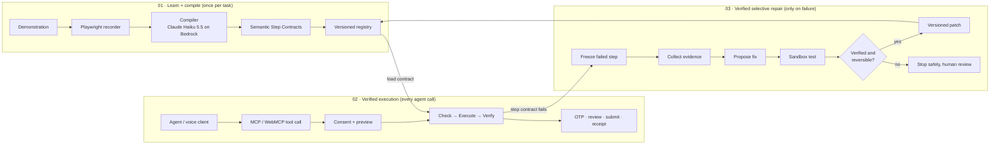

# MCPify

**An MCP builder for legacy websites. Build your site for humans; MCPify makes it agent-ready.**

> Team **khaos** · wHACKiest 2026 · Track 2: *Beyond the Browser*
> Status: 🚧 10-day buildathon in progress. Everything below describes the design we are building; performance numbers will be added only after we measure them.

---

## The problem

Most of the web was built only for humans. Government portals, university systems, insurance and enterprise intranets usually have **no API and no MCP server**, so AI agents cannot use them reliably.

Today an agent has two bad options:

| Option | What goes wrong |
|---|---|
| **Computer-use agents** (screenshot → think → click) | One screenshot and one model call **per step**: slow, expensive, and prone to misclicks on long forms |
| **Scrapers / unofficial wrappers** | Blocked by anti-bot defences, break the site's Terms of Service, and fail silently when the page changes |
| **Official integration** | Slow. India's UMANG platform has integrated **2,132 services** (NeGD, March 2025) since its 2017 launch |

The cost is highest for people who most need help:

- India has **958 million** people online, **548 million** of them rural (IAMAI–Kantar, *Internet in India 2025*).
- Yet only **24.2%** of rural men and **15.9%** of rural women aged 15–24 can send an email with an attachment (NSS 78th Round, 2020–21).
- **5.67 lakh** Common Services Centres exist largely so that someone else fills online forms for citizens (PIB / MeitY, Oct 2025), across **22** scheduled languages on portals that are mostly English-first.

AI agents could close this gap, but only if websites become something agents can use safely.

## The solution

MCPify turns a task on any legacy website into **verified MCP tools** that any AI agent can call, without screenshots and without guessing.

| | |
|---|---|
| **1** recording | A person (site owner or volunteer) does the task once |
| **8**-part step contracts | MCPify compiles the recording into **Semantic Step Contracts** |
| **1** script tag | The site owner publishes the tools with no backend changes |
| **0** model calls per routine step | Agents run the tool as verified code (design target) |

**Creating** a tool takes minutes, once. **Using** it takes seconds, every time.

### Two modes

- **Owner mode (official):** the website owner adds one `<script>` tag. The site exposes approved tools through **WebMCP** (`navigator.modelContext`) in the page, and through a remote **MCP server** for any agent. No anti-bot or ToS conflict, because the site itself offers the tools.
- **User mode (for sites that have not joined yet):** the MCPify Chrome extension runs the same tools **inside the user's own logged-in tab**, only with consent and while the user is present. No credentials leave the browser.

## How it works



### Semantic Step Contracts

Each step of a tool is a contract, not just a recorded click:

```json
{
  "step": "enter_annual_income",
  "intent": "Fill the applicant's annual family income",
  "param": "annual_income",
  "locators": ["label:Annual Income", "#txtIncome", "near:'Income Details'"],
  "pre": "Income section is visible",
  "post": "Field shows the entered value; no validation error",
  "risk": "fill",
  "repair": "auto_allowed",
  "evidence": "trace + signed receipt"
}
```

### Risk-aware execution

| Risk class | Rule |
|---|---|
| `read` | Runs freely |
| `fill` | Runs; automatic repair allowed |
| `commit` (Next, Save, Submit) | Needs the user's review and confirmation |
| `auth` / irreversible (login, OTP, payment) | Human only; **never** automatically repaired |

**Dry-run mode** blocks every `commit` step and, at the network level, every request that would send data. We use it to demonstrate on real government websites without submitting anything.

### Verified selective repair

When a website changes, MCPify does not re-learn the whole site. It freezes only the broken step, collects evidence (current DOM and the step's intent), proposes a fix, replays it in a sandbox and checks the postcondition. A fix is applied as a versioned patch only if it is **verified and reversible**; otherwise the tool stops and asks a human.

## Run it

```bash
corepack enable && pnpm install
pnpm --filter @mcpify/portals exec playwright install chromium
docker compose up -d          # Postgres
pnpm demo                     # builds mcpify.js + extension, then API :4000, portals :5101-5103, MCP server :4100
pnpm --filter @mcpify/dashboard dev    # owner dashboard :3000 (optional)
```
| URL | What |
|---|---|
| http://localhost:4100 | live run view (every step: check → do → verify) |
| http://localhost:4100/mcp | MCP endpoint (Claude Code in this repo picks it up from `.mcp.json`) |
| http://localhost:3000 | owner dashboard: tools, runs, repairs, receipts, audit |
| http://localhost:5101 / 5102 / 5103 | demo portals (scholarship, fees, bus pass); `/phone` shows OTPs, `/__lab` changes the layout live |

Make a new tool: `pnpm --filter @mcpify/recorder record --site scholarship --task <name>` → `pnpm --filter @mcpify/compiler compile --recording <file>` → `pnpm --filter @mcpify/mcp-server approve <draft.json>`.
Chrome extension: `pnpm build:web`, then load `apps/extension/dist` unpacked. Benchmarks: `pnpm --filter @mcpify/bench bench` (results in `bench/results/summary.md`).
Tests: `pnpm test` (Postgres must be running). Status of every part: `docs/STATUS.md`.

## Tech stack

| Layer | Tools |
|---|---|
| Experience | Chrome extension (user mode), Next.js owner dashboard on AWS Amplify |
| Agent interface | **MCP server** (remote, for any agent) · **WebMCP** (in-page tools; MCP-B polyfill until browsers ship it) |
| Intelligence | Claude Haiku 5.5 on Amazon Bedrock (compile + repair) · ElevenLabs Agents / Sarvam (Kannada and Hindi voice client that calls our MCP tools) |
| Automation | Playwright recorder · Verified engine (check → execute → verify) on AWS Fargate |
| Data and cloud | RDS PostgreSQL + S3 (registry, audit log, traces) · AWS KMS (signed receipts) · .xyz domains |

## Demo plan

- **2–3 demo portals we build and own:** owner mode, full submit, live self-repair when a judge changes the layout.
- **2–3 real government websites:** user mode in **dry-run**, with zero data sent.
- **Benchmarks:** MCPify vs a computer-use agent on time per task and model calls per task, 20+ runs per flow, and repair rate across 10 deliberate layout changes.

## Responsible use

- Never stores passwords or OTPs; the user enters their own OTP and solves any CAPTCHA themselves.
- No submission without the user's review and confirmation; every action produces a receipt and an audit entry.
- Never automates login, OTP or payment steps without a human.
- Real third-party sites are used only in dry-run, at human pace, and only where their terms allow it.

## Team khaos

| Role | Name |
|---|---|
| Lead | Chaithanya R |
| Member | Sinchana Jeppu |
| Member | Rohan N Karadigudd |
| Member | Subhash Kashyap K H |
